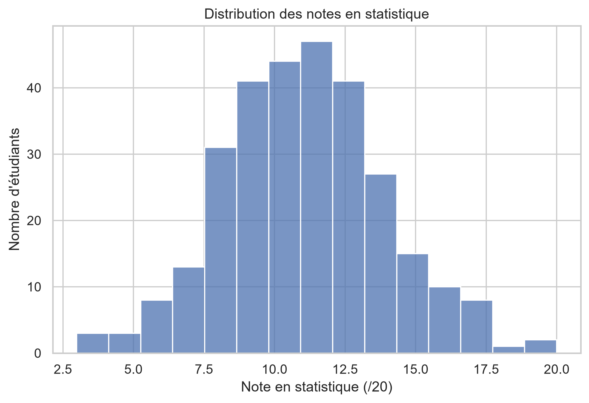
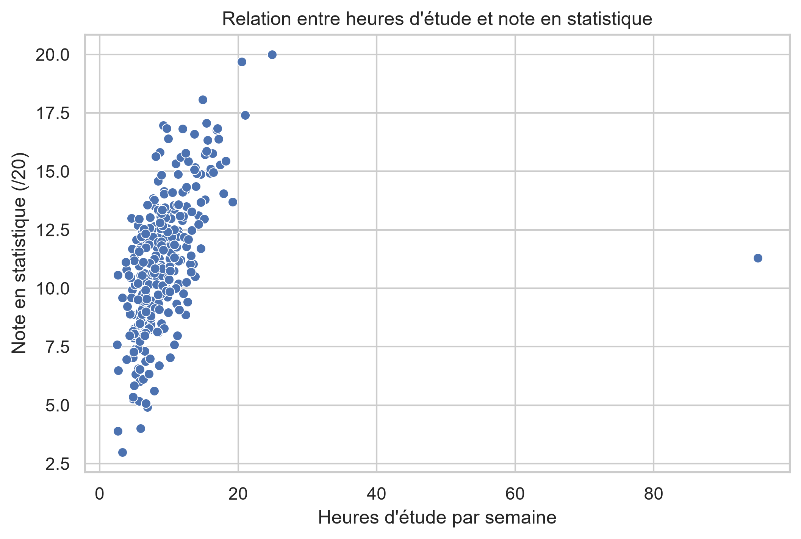
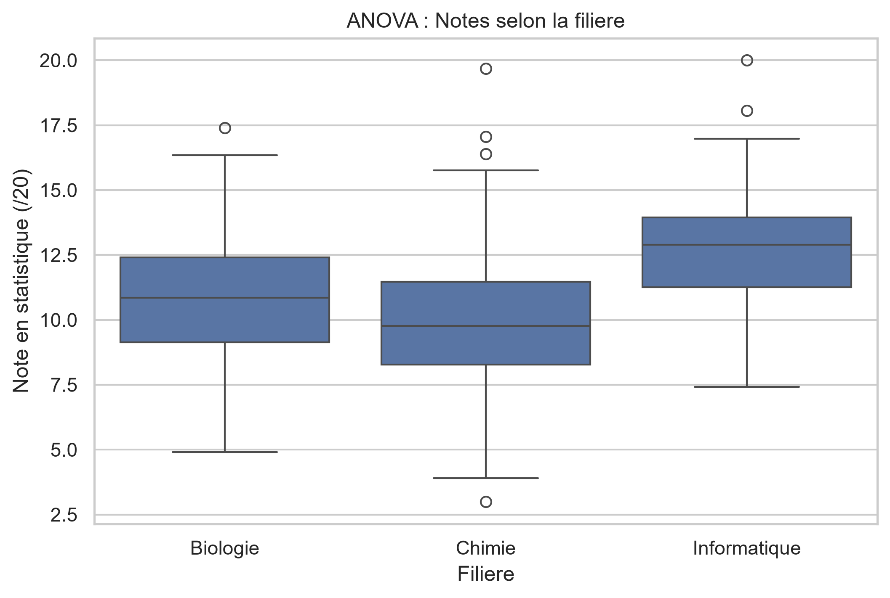
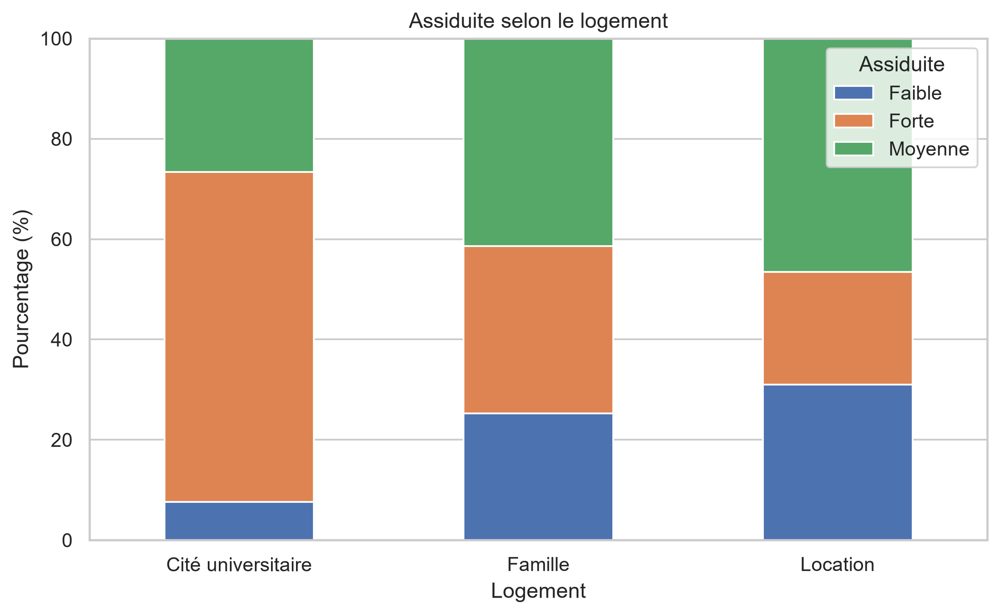

# Student Performance Analysis

## Project Overview
This academic project investigates factors associated with
students' performance in statistics using a simulated dataset
of 300 students.

Developed as part of the Data Analysis and Classification
module at FSBM - Hassan II University of Casablanca.

## Objectives
- Clean and explore the dataset.
- Analyze the relationship between study hours and grades.
- Compare academic performance across academic disciplines.
- Investigate associations between categorical variables.

## Statistical Methods
- Descriptive Statistics
- Simple Linear Regression
- One-way ANOVA
- Chi-Square Test of Independence
- Residual Analysis
- Hypothesis Testing

## Technologies
- Python
- Pandas
- NumPy
- SciPy
- Matplotlib
- Seaborn

## Dataset
The dataset contains 300 simulated students from three
academic disciplines: Biology, Chemistry and Computer Science.

## Data Visualizations

### Grade Distribution

### Linear Regression

### ANOVA

### Chi-Square Test

## Installation
Install the required dependencies:

    pip install -r requirements.txt

## Usage

    python projet_etudiant.py

## Project Report
[Read the full statistical analysis report](rapport_analyse_donnees.pdf)

## Academic Context
- Program: Licence d'Excellence in Artificial Intelligence
- Institution: Faculty of Sciences Ben M'Sik (FSBM)
- University: Hassan II University of Casablanca
- Academic Year: 2026-2027